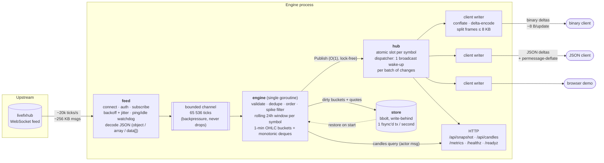

# Architecture

## Data flow

Every arrow on the hot path is in-process; there is no network hop or
serialisation between ingest and distribution.

## Components

| Package | Responsibility |
|---|---|
| `internal/feed` | Owns the upstream session: dial, `auth`, wait for `authenticated`, `subscribeMarketPrice`, read loop. Reconnects with exponential backoff and jitter. Auth rejection uses the maximum backoff. A WebSocket ping plus a read deadline detects half-open connections. Accepts single objects, JSON arrays and `{"data":[...]}` batches, and reads `bid/ask` or `buy/sell`. Ignores the upstream `high/low/percentage/*_24h` fields entirely. |
| `internal/engine` | The single writer of all market state. Validates, dedupes, orders and spike-filters ticks, then maintains each symbol's rolling window and publishes quotes. Expires window buckets every second, and publishes when an old extreme ages out. Hands dirty state to the store. Serves candle queries through its actor loop. |
| `internal/window` | The rolling-window data structure: 1-minute OHLC buckets plus monotonic max/min deques. High and low are O(1); each bucket is pushed and evicted once. |
| `internal/server` | Downstream WebSocket server and HTTP API. Contains the hub (latest state plus wake-ups), per-client subscription, conflation, encoding, frame splitting, rate and connection limits, and slow-client eviction. |
| `pkg/protocol` | The wire formats (binary delta and JSON delta). Encoder and decoder are shared by the server and by Go clients. |
| `internal/store` | bbolt persistence of window buckets and last quotes. A write-behind goroutine commits each batch in a single transaction. Prunes data past retention. |
| `internal/metrics` | Prometheus instruments. |
| `cmd/mockfeed` | Synthetic upstream for load and fault testing. |
| `cmd/wsclient` | Decoding client and load generator; reports latency and payload sizes. |

## Life of a tick

1. **Receive.** The feed reads a WebSocket message and stamps `RecvNs` *before* decoding, so decode time counts toward measured latency. It decodes the message into `Tick`s and sends them on the engine channel. If that channel is full, the send blocks, which pushes back on the upstream TCP connection instead of dropping prices.
2. **Validate.** Prices must be finite and positive, and the quote must not be crossed (`bid ≤ ask`). The symbol must match `[A-Za-z0-9._/-]{1,24}`, and the registry is capped at 4,096 symbols.
3. **Event time.** If upstream sends a timestamp (seconds, ms, µs, ns or RFC 3339), it is used, and anything more than `MAX_CLOCK_SKEW` in the future is rejected. Otherwise the event time is the receive time.
4. **Dedupe.** A bid/ask identical to the current quote is dropped. On the live feed most updates are exact repeats.
5. **Out of order.** A tick older than the symbol's current event time is still folded into the high/low of the bucket it belongs to, but it does **not** replace the newer current price. A tick older than the whole window is dropped.
6. **Spike filter.** A move larger than `SPIKE_THRESHOLD_PCT` from the last accepted price is held back. It is accepted only after `SPIKE_CONFIRM_TICKS` *distinct* prices agree on the new level, or after the level holds for `SPIKE_CONFIRM_AFTER`.
7. **Window update.** The engine expires old buckets, folds the price into the current bucket and updates the deques. It then reads high, low and open in O(1). `change_24h = (price − open_of_oldest_bucket) / open × 100`.
8. **Publish.** The engine stores a new immutable `Quote` in the symbol's atomic slot and nudges the dispatcher. Total engine time is about 150 ns per tick.
9. **Fan-out.** The dispatcher closes a broadcast channel, which wakes every idle writer at once. Each writer compares the slot pointers of its subscribed symbols with the pointers it last sent, then encodes only the changes. Those become delta records in one or more frames of at most `MAX_FRAME_BYTES`.

## Key design decisions and trade-offs

### Single-goroutine engine (actor model)
All symbol state belongs to one goroutine, so there are no locks, the order of operations is fully determined, and the code is easy to reason about. It costs about 150 ns per tick, roughly 6 million ticks/s on one core, which is about 300× the load-test rate. *Trade-off:* it uses one core. Because symbols are independent, scaling past that means sharding by symbol hash into N engine goroutines, each with its own channel. The window, store batching and hub slots are already per symbol, so that is a local change.

### Bucketed rolling window
An exact 24h high/low over raw ticks would need memory proportional to tick rate. At 20k ticks/s that is about 1.7 billion entries per day. Instead each symbol keeps at most 1,441 one-minute OHLC buckets, around 60 KB, whatever the tick rate. Two monotonic deques give O(1) high/low with amortised O(1) updates. *Trade-off:* the window's trailing edge has one-minute resolution, so the statistics cover between 24h and 24h + 1m. `BUCKET` is configurable (for example `10s` gives 8,641 buckets per symbol). The buckets double as 1-minute candles for `/api/candles`, so the OHLC bonus comes for free.

### Price basis for the statistics
The feed provides bid and ask, while the spec asks for one high, low and % change. These are computed on the **mid** price by default (`PRICE_BASIS=mid|bid|ask`). Mid is unaffected by spread widening, which matters here: ADAUSD shows a 25% spread on this feed. *Observation:* upstream's own `high/low` appear to be ask-based, because for wide-spread crypto the bid sits below upstream's `low`. Set `PRICE_BASIS=ask` to match that convention.

### Pull-based fan-out with conflation
The first version pushed every tick to every subscriber from the engine goroutine. The load test showed that cost is O(clients) per tick: at 500 clients the engine slowed to about 98 µs per tick, its queue grew, and latency reached seconds (see [CHALLENGES.md](CHALLENGES.md)). The current design keeps the engine at O(1) per tick:

- latest state lives in per-symbol atomic pointers;
- there is one broadcast wake-up per batch of changes;
- each writer pulls only what changed.

Conflation follows naturally from this. A slow client receives the newest price for each symbol rather than a backlog, so memory stays bounded by the number of symbols. *Trade-off:* a slow client can skip intermediate prices. For a price display that's correct behaviour; a consumer that needs every tick (for example an audit trail) would need a durable log such as Kafka instead.

### Binary delta protocol, JSON for humans
Binary frames carry a varint symbol id, a field-change bitmask, and zig-zag varint deltas of fixed-point integers, which averages about 7–8 bytes per update. JSON mode sends only the fields that changed, and permessage-deflate is negotiated for it. Binary is not deflated: its frames are already dense, and compression would mostly add CPU time and latency. Every frame, including the snapshot sent on subscribe and the symbol table, is split to stay under `MAX_FRAME_BYTES` (default 8 KB, hard cap 10 KB). *Trade-off:* delta encoding makes each connection stateful. This is safe because WebSocket over TCP is ordered and reliable, a reconnect starts with full records, and every frame carries a sequence number so a client can detect a gap.

### Write-behind persistence (bbolt)
bbolt is embedded, pure Go, transactional and crash-safe (copy-on-write B+tree, fsync on commit), and needs no extra container. The engine hands the buckets and quotes that changed to a store goroutine once a second, and the store writes them in a single transaction, about 3 ms. *Trade-off:* a hard crash (`kill -9`, power loss) can lose up to one flush interval of updates. A graceful stop (`SIGTERM` / `docker stop`) drains the queue and writes a final batch before exiting. On restart, 39 symbols with about 30 minutes of history were restored in 0.85 ms. A full 24h for 61 symbols is about 88k buckets, roughly 3 MB, and restore cost is linear in that. Synchronous per-tick writes, or Redis on the hot path, would add milliseconds of latency to every tick and only shrink that one-second window. For several engine replicas sharing state, the store interface could be backed by Redis or a time-series database.

### Backpressure, not drops
If the engine ever falls behind, the feed's send on the bounded channel blocks, and TCP flow control pushes back on upstream. The prices the window depends on are never silently dropped. Downstream, the opposite policy applies: slow clients are conflated, and a client that cannot accept one frame within `CLIENT_WRITE_TIMEOUT` (5 s) is disconnected. One slow consumer can never stall ingest.

### Fault-tolerance summary

| Fault | Handling |
|---|---|
| Upstream disconnect or reset | Reconnect with exponential backoff (0.5 s → 30 s) and jitter; resubscribe; backoff resets after a stable minute. |
| Half-open TCP / silent feed | Ping every `FEED_IDLE_TIMEOUT/3`; reconnect if no frame or pong arrives within `FEED_IDLE_TIMEOUT` (30 s). |
| Auth rejected or no auth reply | Auth timeout of 10 s; on rejection, wait the maximum backoff instead of hammering the server. |
| Duplicates (repeats, snapshot replay after reconnect) | Value dedupe against the current quote. |
| Out-of-order / late ticks | Feed the historical bucket's high/low only, never the current price; reject anything older than the window. |
| Future-dated ticks (clock skew) | Rejected beyond `MAX_CLOCK_SKEW`. |
| Bad ticks (spikes) | Threshold plus distinct-tick confirmation or a hold time. |
| Malformed / partial messages | Logged and counted; the session continues. |
| Message-rate spikes | 64k-tick buffer, about 150 ns per tick, backpressure to TCP; 4 MB message limit. |
| Process restart / crash | Restore from bbolt; clients get last-known prices with `upstream:false` until the feed is back. |
| Slow or abusive clients | Conflation, write timeout, control-message token bucket (10/s, burst 20; then close 1008), per-IP and global connection caps. |
| Container crash | `restart: unless-stopped`; Docker `HEALTHCHECK` via `pricing-engine -healthcheck`. |

## Scaling path

- **More symbols or ticks:** shard the engine by symbol (see above). The hub slots and window state are already per symbol.
- **More clients:** fan-out is O(changed symbols × clients) per wake-up and runs on the clients' own goroutines. `FANOUT_INTERVAL` (for example `5ms`) caps wake-ups per second to trade a few ms of latency for fewer, larger frames. Past one box's network or CPU, run N stateless gateway replicas behind a load balancer. Each gateway would subscribe to the engine over this same binary protocol, which `pkg/protocol` already provides as client code, or to a broker such as NATS.
- **High availability:** two engines on independent upstream sessions, with clients failing over between them. Statistics converge because the store is per instance and the window refills from the feed.
